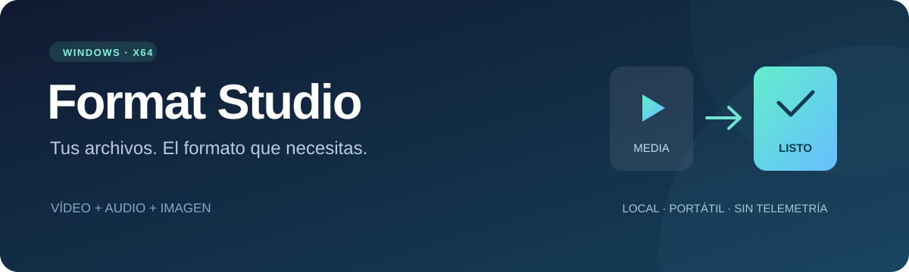

### Convierte, recorta y une. Todo en tu equipo.

**Vídeo · Audio · Imagen · PDF · ISO** &nbsp; | &nbsp; **Windows 10/11 · 64 bits**

[**⬇ Descargar Format Studio**](https://github.com/oficialdjcacho/FormatStudio/releases/latest) · [Ver versiones](https://github.com/oficialdjcacho/FormatStudio/releases)

Portátil &nbsp; • &nbsp; Sin instalación &nbsp; • &nbsp; Sin telemetría &nbsp; • &nbsp; Conversión sin conexión

---

## Un solo lugar para tus archivos multimedia

Convierte archivos por lotes, extrae audio de un vídeo y prepara clips con un editor de segmentos. Utiliza los ajustes rápidos o controla cada detalle de la salida: códec, bitrate, resolución, FPS, muestreo y canales.

| 🎬 Vídeo | 🎵 Audio | 🖼️ Imagen |
| :--- | :--- | :--- |
| MP4, MKV, AVI, WEBM, MOV | MP3, WAV, FLAC, M4A, OGG | JPG, PNG, WEBP |
| MPG, WMV, FLV, VOB, 3GP, TS | AAC, WMA, OPUS, AC3, AIFF, WV | BMP y GIF estático |

**27 formatos de salida**, con las opciones de codificación compatibles con cada contenedor.

## Diseñado para convertir y editar

- **Cola por lotes:** organiza tus archivos, sigue el progreso y cancela cuando lo necesites.
- **Editor de segmentos:** selecciona inicio y final, corta, copia, pega, reordena y une clips.
- **División flexible:** separa un segmento por duración, por partes iguales o en la posición del cursor.
- **Ajustes avanzados de vídeo:** H.264, H.265, AV1 y otros códecs según formato; CRF o bitrate, dos pasadas, VBV, dimensiones personalizadas, FPS y encuadre.
- **Control de audio:** bitrate o VBR, frecuencia de muestreo, canales, volumen, fundidos y profundidad PCM/FLAC.
- **Edición no destructiva:** conserva los originales y genera nombres nuevos cuando ya existe un resultado.

## Más herramientas, en el mismo escritorio

| Herramienta | Qué puedes hacer |
| :--- | :--- |
| **Multiplexar y separar pistas** | Añadir audio externo, ajustar desfase y repetición, conservar pistas o extraerlas sin recodificar. |
| **Fast Clip y división** | Cortar y dividir sin recodificar, por duración o tamaño aproximado. |
| **Logo, Delogo y velocidad** | Insertar una imagen, interpolar una región y ajustar velocidad conservando el tono. |
| **Audio** | Mezclar, unir con silencios, aplicar volumen, velocidad, fundidos y normalización. |
| **PDF** | Unir, dividir, extraer páginas y texto, imágenes a PDF, cifrar, descifrar y recomprimir. |
| **ISO** | Crear ISO9660, examinar y extraer imágenes ISO9660/Joliet sin montar unidades. |
| **Captura y reproductor** | Grabar una región de pantalla con audio local opcional y reproducir archivos con pausa, búsqueda y volumen. |

**Descargador opcional:** se ofrece en otro ZIP, con acceso a Internet al iniciar una descarga. Admite sitios compatibles con la versión incluida y enlaces directos; no usa cookies del navegador ni descarga componentes. El programa principal sigue funcionando sin conexión y no necesita esa utilidad.

## Empieza en tres pasos

1. Descarga **`FormatStudio-2.2-win-x64.zip`** desde [Releases](https://github.com/oficialdjcacho/FormatStudio/releases/latest).
2. Descomprime **todo el contenido** en una carpeta local y abre **`FormatStudio.exe`**.
3. Elige el formato, añade tus archivos y pulsa **Iniciar**.

No necesitas instalar .NET ni códecs adicionales. Mantén el ejecutable junto a sus DLL y las carpetas `tools` y `licenses`.

> **Para afinar la salida:** pulsa **Ajustes de salida…** en la ventana principal o en el editor. Los niveles de calidad rápidos son solo atajos.

La salida predeterminada se guarda en `%LOCALAPPDATA%\FormatStudio\Output`. Puedes elegir otra carpeta local y consultar los resultados desde la aplicación.

## Local, sencillo y bajo tu control

La conversión no sube archivos a servidores, no descarga componentes durante el uso y no incluye telemetría ni actualizaciones automáticas. La aplicación no solicita privilegios de administrador. Sus motores se verifican por SHA-256 antes de ejecutarse.

En cada release encontrarás un archivo **`SHA256SUMS.txt`** para comprobar la descarga. El ejecutable no dispone de firma comercial: Windows puede mostrar un aviso de editor desconocido.

## Antes de empezar

- Requiere **Windows 10 u 11 x64**.
- El reproductor ofrece previsualización audiovisual hasta 960 × 540 / 25 FPS. El editor conserva su vista de segmentos.
- GIF se exporta como imagen fija. VOB no genera una estructura de DVD.
- Fast Clip y división sin recodificar dependen de fotogramas clave; el tamaño por parte es aproximado.
- PDF no incluye OCR, PDF a imagen ni conversión a DOC/XLS. Recomprimir no garantiza reducir el tamaño.
- ISO no incluye UDF/CSO, discos físicos, imágenes arrancables ni DRM.
- El audio de captura depende de las entradas DirectShow disponibles; no siempre hay una entrada de sonido del sistema.
- Aumentar bitrate, resolución o muestreo no recupera calidad perdida en el origen.
- Para desinstalar, elimina la carpeta del programa. Tus conversiones permanecen en la carpeta de salida.

---

**Format Studio · Por [oficialdjcacho](https://github.com/oficialdjcacho)**

Aplicación bajo [licencia MIT](LICENSE). Incluye componentes de FFmpeg, Microsoft .NET, PDFsharp y PdfPig con sus propias licencias, disponibles dentro de la descarga.

